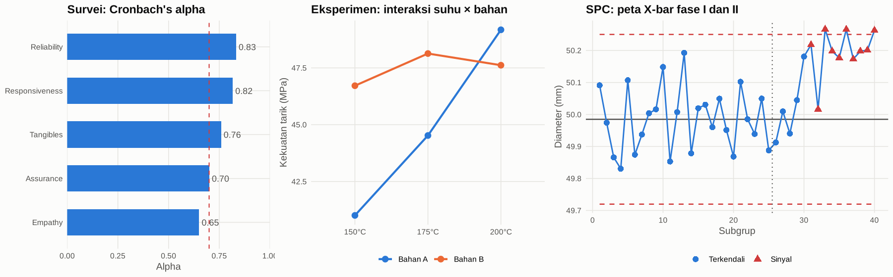
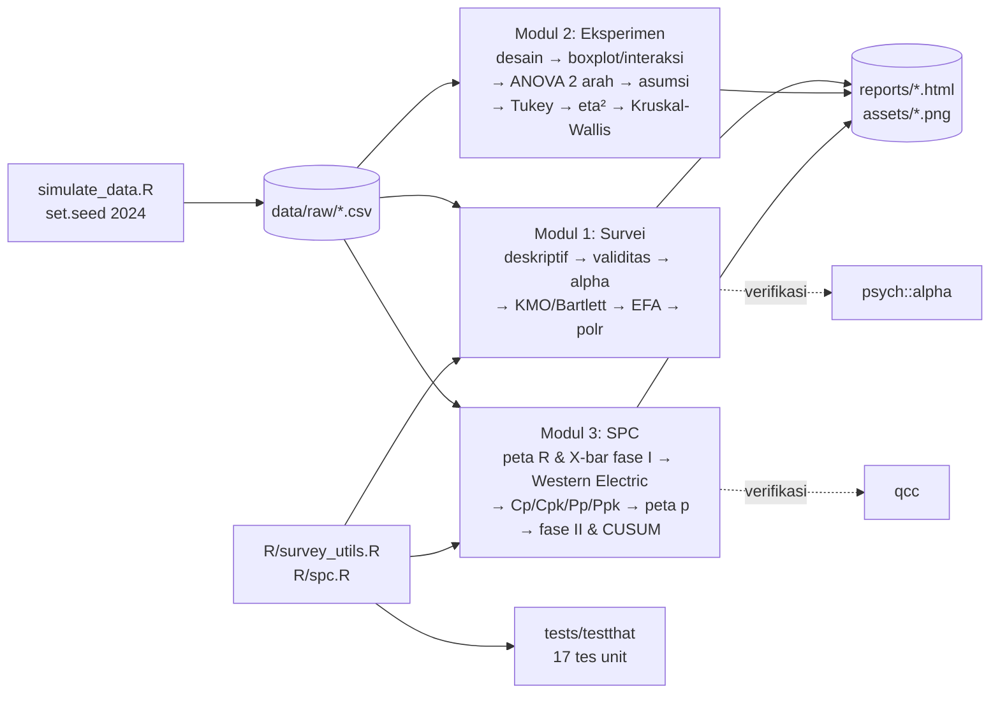

# Analisis Survei, Desain Eksperimen, dan Statistical Process Control dengan R

Portofolio tiga analisis statistika terapan yang dapat direproduksi sepenuhnya dengan satu
perintah: validitas–reliabilitas dan regresi ordinal untuk **survei kepuasan pelanggan**,
**ANOVA faktorial dua arah** untuk eksperimen rekayasa, dan **peta kendali serta analisis
kapabilitas** untuk pengendalian mutu produksi.

[](https://www.r-project.org/)
[](LICENSE)
[](https://github.com/imman20/analisis-survei-dan-eksperimen-r/actions/workflows/ci.yml)

## English summary

I use reproducible simulated data to demonstrate survey analysis, factorial experiments, and statistical process control in R. I evaluate reliability and factor structure for 400 survey respondents and fit an ordinal satisfaction model. In the 30-run experiment, the temperature-by-material interaction has a p-value of 0.0077. The process study estimates Cpk at 1.071, which indicates marginal capability despite initial stability. I reproduce the reports and unit tests with `Rscript run_all.R` after installing the documented R packages.



## Daftar Isi

- [Latar Belakang dan Pertanyaan Analisis](#latar-belakang-dan-pertanyaan-analisis)
- [Dataset](#dataset)
- [Metodologi](#metodologi)
- [Hasil Utama](#hasil-utama)
- [Struktur Folder](#struktur-folder)
- [Cara Menjalankan](#cara-menjalankan)
- [Teknologi](#teknologi)
- [Padanan SPSS/Minitab](#padanan-spssminitab)
- [Keterbatasan dan Pengembangan Lanjutan](#keterbatasan-dan-pengembangan-lanjutan)
- [Lisensi](#lisensi)
- [Kontak](#kontak)

## Latar Belakang dan Pertanyaan Analisis

Tiga pekerjaan yang paling sering dihadapi seorang *statistician / research analyst* dan
*quality control analyst* adalah: menilai kualitas instrumen survei dan menemukan pendorong
kepuasan, membuktikan pengaruh faktor proses melalui eksperimen, serta memantau dan menilai
kapabilitas proses produksi. Di repositori ini saya mengerjakan ketiganya secara lengkap, dari
data mentah sampai rekomendasi, dengan kode yang saya uji unit dan hasil yang saya verifikasi
silang terhadap paket standar (`psych`, `qcc`).

| Modul | Pertanyaan bisnis | Laporan |
|---|---|---|
| 1. Survei kepuasan (SERVQUAL) | Apakah kuesioner valid dan reliabel? Dimensi layanan mana yang paling menentukan kepuasan keseluruhan? | [`reports/01_analisis_survei_kepuasan.html`](reports/01_analisis_survei_kepuasan.html) |
| 2. Desain eksperimen | Apakah suhu dan jenis bahan memengaruhi kekuatan tarik, dan apakah efek suhu bergantung pada bahan? | [`reports/02_desain_eksperimen_anova.html`](reports/02_desain_eksperimen_anova.html) |
| 3. SPC dan kapabilitas | Apakah proses terkendali dan mampu memenuhi spesifikasi? Seberapa cepat pergeseran kecil terdeteksi? | [`reports/03_statistical_process_control.html`](reports/03_statistical_process_control.html) |

## Dataset

**Seluruh data adalah simulasi** yang saya bangkitkan secara deterministik dengan
`R/simulate_data.R` dan `set.seed(2024)`. Alasannya: data survei dan data proses nyata
umumnya rahasia, dan dengan simulasi "jawaban benar" diketahui sehingga pembaca dapat menilai
apakah metode berhasil menemukannya kembali.

| Berkas | Ukuran | Parameter pembangkit |
|---|---|---|
| `data/raw/survey_kepuasan.csv` | 400 × 25 | 5 skor laten dimensi berkorelasi 0,45; 20 item = loading (0,55–0,85) × laten + galat, dipotong ke Likert 1–5; item `emp_4` sengaja lemah (loading 0,35); kepuasan keseluruhan ordinal 1–5 dengan bobot terbesar pada Reliability (0,9) dan Responsiveness (0,7) |
| `data/raw/eksperimen_faktorial.csv` | 30 × 5 | Faktorial 3 (suhu 150/175/200 °C) × 2 (bahan A/B) × 5 replikasi; rata-rata sel 40/46/48 (A) dan 47/50/49 (B) MPa; galat N(0; 2,2²); urutan run diacak |
| `data/raw/spc_fase1.csv` | 125 × 4 | 25 subgrup × 5 pengukuran, N(50,00; 0,20²) stabil |
| `data/raw/spc_fase2.csv` | 75 × 4 | 15 subgrup × 5; subgrup 6–15 bergeser ke μ = 50,15 (+0,75σ) |
| `data/raw/spc_atribut.csv` | 30 × 3 | 30 lot × 200 unit, Binomial(200; 0,03); lot 18–19 p = 0,09 |

Kamus data lengkap: [`docs/kamus_data.md`](docs/kamus_data.md).

## Metodologi



Uraian keputusan metodologis dan alasannya: [`docs/metodologi.md`](docs/metodologi.md).

## Hasil Utama

Semua angka di bawah diambil langsung dari laporan yang dirender oleh `run_all.R`.

### Modul 1: Survei kepuasan (n = 400)

| Dimensi | Cronbach's alpha | Interpretasi | Item dengan r item-total < 0,30 |
|---|---|---|---|
| Tangibles | 0,759 | Dapat diterima | - |
| Reliability | 0,833 | Baik | - |
| Responsiveness | 0,816 | Baik | - |
| Assurance | 0,700 | Dapat diterima | - |
| Empathy | 0,650 (0,684 tanpa `emp_4`) | Dipertanyakan | `emp_4` (r = 0,280) |

- KMO = 0,876; Bartlett χ² = 2463,3 (df = 190), p < 0,001 → data layak difaktorkan.
- Parallel analysis menyarankan **5 faktor**; EFA (minres, oblimin) menempatkan **20 dari 20 item**
  pada faktor yang sesuai dimensi teoretisnya (RMSEA = 0,008; TLI = 0,998; korelasi antar faktor 0,26–0,45).
- Regresi logistik ordinal (LR χ² = 506,8, df = 5, p < 0,001; McFadden R² = 0,402), odds ratio per kenaikan 1 poin skor dimensi:

| Dimensi | OR | IK 95% | p |
|---|---|---|---|
| **Reliability** | **8,17** | 5,69–11,74 | < 0,001 |
| **Responsiveness** | **4,45** | 3,19–6,20 | < 0,001 |
| Empathy | 2,49 | 1,83–3,40 | < 0,001 |
| Assurance | 2,32 | 1,66–3,24 | < 0,001 |
| Tangibles | 1,96 | 1,41–2,74 | < 0,001 |

**Insight:** (1) instrumen reliabel dan struktur 5 dimensi terkonfirmasi; (2) prosedur validitas
berhasil menangkap satu-satunya item yang sengaja dilemahkan; (3) Reliability dan Responsiveness
adalah pendorong kepuasan terkuat, sehingga prioritas perbaikan layanan ada di dua dimensi ini.

### Modul 2: Eksperimen faktorial 3 × 2 (30 run)

| Sumber | F | p-value | η² parsial |
|---|---|---|---|
| Suhu | 8,84 | 0,0013 | 0,424 (besar) |
| Bahan | 8,59 | 0,0073 | 0,264 (besar) |
| **Suhu × Bahan** | **6,00** | **0,0077** | 0,333 (besar) |

- Asumsi terpenuhi: Shapiro-Wilk W = 0,954 (p = 0,217); Levene F = 0,70 (p = 0,628). R² terkoreksi = 0,534.
- Tukey HSD: Bahan B lebih kuat dari A sebesar **+5,71 MPa pada 150 °C** (p = 0,012), +3,61 MPa pada
  175 °C (p = 0,210), dan **−1,56 MPa pada 200 °C** (p = 0,906). Sel terbaik: 200 °C + Bahan A (49,18 MPa).
- Kruskal-Wallis untuk suhu: H = 8,10, p = 0,017 (konsisten dengan ANOVA). Wilcoxon untuk bahan
  (p = 0,110) tidak signifikan karena mengabaikan suhu dan interaksi. Ini ilustrasi mengapa rancangan
  faktorial lebih efisien.

**Insight:** (1) keunggulan Bahan B hanya berlaku pada suhu rendah; (2) pada 200 °C Bahan A yang
lebih murah memberi kekuatan setara atau lebih tinggi. Ini peluang penghematan tanpa mengorbankan mutu;
(3) rekomendasi bahan tidak boleh dibuat tanpa menyebut suhu operasi.

### Modul 3: SPC (diameter poros, spesifikasi 49,35–50,65 mm)

| Statistik | Nilai |
|---|---|
| Peta X-bar fase I (CL / LCL / UCL) | 49,985 / 49,720 / 50,250 mm, 0 sinyal dari 25 subgrup |
| Peta R fase I (CL / UCL) | 0,460 / 0,972 mm, 0 sinyal |
| σ within (R-bar/d2) | 0,198 mm |
| **Cp / Cpk** | **1,096 / 1,071** (qcc: 1,096 / 1,071) |
| Pp / Ppk / Cpm | 1,063 / 1,038 / 1,093 |
| Perkiraan di luar spesifikasi | 1.041 ppm (0,10 %) |
| Peta p (p-bar / UCL) | 0,0372 / 0,0773, lot **18 dan 19** di luar kendali |
| Deteksi pergeseran fase II (mulai subgrup 6) | Western Electric: subgrup 6 (aturan 2); Shewhart 3σ saja: subgrup 8; CUSUM: subgrup 8 |

**Insight:** (1) proses stabil tetapi kapabilitasnya **marginal** (Cpk 1,07 < 1,33), sehingga perlu
pengurangan variasi, bukan penyetelan pusat, karena Cp ≈ Cpk; (2) aturan Western Electric mendeteksi pergeseran 0,75σ pada subgrup 6, lebih cepat daripada batas 3σ saja; CUSUM dan batas 3σ sama-sama memberi sinyal pada subgrup 8; (3) lonjakan cacat lot 18–19
terdeteksi peta p dan harus diinvestigasi sebagai penyebab khusus.

## Struktur Folder

```
analisis-survei-dan-eksperimen-r/
├── R/                         # fungsi reusable berdokumentasi roxygen
│   ├── simulate_data.R        #   pembangkit data simulasi (set.seed 2024)
│   ├── survey_utils.R         #   alpha, korelasi item-total, skor dimensi, tabel OR
│   ├── spc.R                  #   konstanta, batas X-bar/R/p, Western Electric, Cp/Cpk
│   ├── plot_theme.R           #   tema dan palet grafik seragam
│   └── make_hero.R            #   gambar panel untuk README
├── analysis/                  # sumber R Markdown tiap modul
├── reports/                   # hasil render HTML (self-contained)
├── data/raw/                  # CSV simulasi
├── data/processed/            # (kosong, untuk data turunan)
├── assets/                    # PNG grafik penting
├── tests/testthat/            # 17 tes unit
├── docs/                      # metodologi, kamus data, padanan SPSS/Minitab
├── .github/workflows/ci.yml   # CI: tes + render
├── run_all.R                  # jalankan semuanya
├── requirements.R / renv.lock / DESCRIPTION
└── README.md · LICENSE · CHANGELOG.md · CONTRIBUTING.md
```

## Cara Menjalankan

Prasyarat untuk pemasangan dependensi terkini: R ≥ 4.5 dan [pandoc](https://pandoc.org/) (sudah termasuk dalam RStudio).

```bash
# 1. Clone
git clone https://github.com/imman20/analisis-survei-dan-eksperimen-r.git
cd analisis-survei-dan-eksperimen-r

# 2. Pasang paket (pilih salah satu)
Rscript requirements.R                                   # versi persis seperti saat laporan dibuat
# atau: Rscript -e 'install.packages("renv"); renv::restore(lockfile = "renv.lock")'
# atau: Rscript -e 'install.packages(c("tidyverse","psych","GPArotation","car","qcc","rmarkdown","knitr","testthat"))'

# 3. Bangkitkan data, render tiga laporan, buat gambar, jalankan tes (± 2 menit)
Rscript run_all.R

# 4. Hanya tes unit
Rscript -e 'testthat::test_dir("tests/testthat")'

# 5. Render satu modul saja
Rscript -e 'rmarkdown::render("analysis/03_statistical_process_control.Rmd", output_dir = "reports", knit_root_dir = getwd())'
```

Laporan HTML terbuka langsung di peramban (`reports/*.html`). Output PDF tidak disertakan
karena lingkungan pembuatan tidak memiliki LaTeX; untuk PDF, pasang `tinytex` lalu ganti
`html_document` menjadi `pdf_document` pada header Rmd.

## Teknologi

Saya mempertahankan versi acuan laporan final pada tabel berikut. Saya menguji ulang dengan R 4.5.0 dan memakai versi itu pada CI karena dependensi transitif terkini memerlukan R ≥ 4.5. Seluruh 27 tabel hasil cocok tepat pada teks dan presisi yang ditampilkan; data, model, laporan HTML, serta gambar final dipertahankan. Rincian ada di [verifikasi penyempurnaan](docs/verifikasi_penyempurnaan.md).

| Komponen | Paket / alat | Versi |
|---|---|---|
| Bahasa | R | 4.3.3 |
| Manipulasi data & grafik | dplyr, tidyr, ggplot2 | 1.1.4, 1.3.1, 3.4.4 |
| Psikometri & EFA | psych, GPArotation | 2.4.1, 2026.8-2 |
| Model ordinal & uji asumsi | MASS, car | 7.3-60, 3.1-2 |
| SPC (verifikasi) | qcc | 2.7 |
| Laporan | rmarkdown, knitr, pandoc | 2.25, 1.45, 3.1 |
| Pengujian & reproduksibilitas | testthat, renv | 3.2.1, 1.0.3 |

Fungsi SPC (konstanta A2/D3/D4/d2, batas kendali, Cp/Cpk, aturan Western Electric) **saya tulis
manual** di `R/spc.R` agar transparan dan dapat diuji unit, lalu **saya verifikasi** terhadap
konstanta Montgomery dan keluaran `qcc` di dalam laporan (selisih batas kendali ≤ 10⁻⁴).

## Padanan SPSS/Minitab

Setiap analisis di repositori ini dipetakan ke menu SPSS dan Minitab (langkah klik dan nama
keluaran yang sebanding) di [`docs/padanan_spss_minitab.md`](docs/padanan_spss_minitab.md),
termasuk catatan perbedaan antar perangkat lunak (jumlah kuadrat Tipe I vs III, rotasi oblik,
estimator sigma).

## Keterbatasan dan Pengembangan Lanjutan

- **Data simulasi**: hasil menunjukkan kemampuan metode, bukan temuan tentang layanan atau proses
  nyata. Struktur yang ditanam relatif "bersih" dibanding data lapangan.
- **EFA memakai korelasi Pearson** pada data Likert; korelasi polikorik (`psych::fa(cor = "poly")`)
  lebih tepat secara teori dan menjadi langkah lanjut yang wajar.
- **Uji proportional odds** dilakukan secara informal; uji Brant (`brant`) atau model
  *partial proportional odds* (`VGAM`) dapat ditambahkan.
- **Eksperimen** hanya 5 replikasi; interval Tukey masih lebar. Rancangan *response surface*
  di sekitar 175–200 °C adalah kelanjutan yang logis.
- **SPC**: pergeseran fase II yang terealisasi (≈ 1,08σ dari rata-rata subgrup 6–15) sedikit lebih
  besar dari nominal 0,75σ karena variasi acak, dan sinyal Western Electric pertama pada subgrup 6
  terbantu satu titik acak di subgrup 5 yang melampaui 2σ. Simulasi ulang dengan banyak replikasi
  (studi ARL) diperlukan untuk membandingkan kinerja deteksi secara adil.
- Belum ada peta EWMA, analisis *gauge R&R*, atau *dashboard* interaktif (Shiny). Ketiganya kandidat
  pengembangan berikutnya.

## Lisensi

Kode dan dokumentasi dilisensikan di bawah [MIT License](LICENSE) © 2025 Immantaka Juniarsa.

## Kontak

**Immantaka Juniarsa**, S1 Statistika, Universitas Airlangga (2024)
GitHub: [@imman20](https://github.com/imman20) · Email: immantakajuniarsa30@gmail.com
